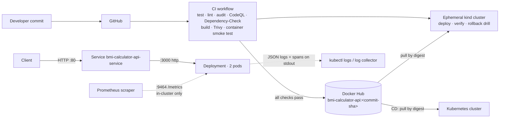

# BMI Calculator API

A small Node.js/Express service that calculates Body Mass Index, delivered through a
gated CI/CD pipeline to Kubernetes, with Prometheus metrics, structured logs and
request tracing.

BMI formula: $BMI=\dfrac{weight_{kg}}{height_{m}^2}$

| | |
|---|---|
| Repository | https://github.com/Ajai-Sharan/bmi-calculator-ci-cd |
| Baseline (preserved) | [`55df096c75ee679d46f012c4e6bd8d2af59b5b56`](https://github.com/Ajai-Sharan/bmi-calculator-ci-cd/tree/55df096c75ee679d46f012c4e6bd8d2af59b5b56), tag `baseline-55df096` — see [docs/BASELINE.md](docs/BASELINE.md) |
| Design and tradeoffs | [docs/DESIGN.md](docs/DESIGN.md) |
| Verification evidence | [docs/EVIDENCE.md](docs/EVIDENCE.md) |

---

## 1. Architecture



**Request path:** client → Service (port 80) → one of 2 ready pods (port 3000) →
Express → validation → BMI calculation → JSON response. The service is stateless and has
no external dependencies (no database, no downstream calls), so the only failure
boundaries are the pod itself and the network path to it.

| Component | File | Purpose |
|---|---|---|
| HTTP app | [src/app.js](src/app.js) | Routes, per-request metrics/logs/spans, 404/500 handling |
| Entrypoint | [src/server.js](src/server.js) | Starts API + metrics listeners, readiness flag, graceful SIGTERM drain |
| Domain logic | [src/bmi.js](src/bmi.js) | BMI calculation and WHO category |
| Validation | [src/validation.js](src/validation.js) | Strict query parsing and range checks |
| Config | [src/config.js](src/config.js) | Environment variables, validated at start-up |
| Observability | [src/metrics.js](src/metrics.js), [src/logger.js](src/logger.js), [src/tracing.js](src/tracing.js) | Prometheus registry, pino JSON logger, OpenTelemetry tracer |
| Container | [Dockerfile](Dockerfile) | Multi-stage, non-root, production deps only |
| Kubernetes | [k8/deployment.yml](k8/deployment.yml), [k8/kustomization.yml](k8/kustomization.yml) | ServiceAccount, Deployment, PDB, Service, generated ConfigMap |
| Delivery | [.github/workflows/ci.yml](.github/workflows/ci.yml), [.github/workflows/cd.yml](.github/workflows/cd.yml) | CI, gated publish, kind verification, CD |
| Operations | [scripts/deploy.sh](scripts/deploy.sh), [scripts/smoke-test.sh](scripts/smoke-test.sh) | Pinned deploy with auto-rollback; user-journey check |

### API

| Endpoint | Port | Purpose |
|---|---|---|
| `GET /bmi?weight=<kg>&height=<m>` | 3000 | `200 {"weight":70,"height":1.75,"bmi":22.86,"category":"Normal"}` |
| `GET /health` | 3000 | Liveness: `{"status":"UP","version":"<commit-sha>"}` |
| `GET /ready` | 3000 | Readiness: `200` when serving, `503` while starting or draining |
| `GET /metrics` | 9464 | Prometheus metrics (not exposed through the Service) |

Validation rules: `weight` 1–700 kg and `height` 0.3–3 m, each given exactly once as a plain
decimal number. Invalid input returns `400` with `error`, per-field `details` and the
`traceId`. Examples: `weight=70abc` → 400 (the baseline silently accepted it as 70),
`height=175` → 400 with a "metres, not centimetres" hint.

### Configuration

| Variable | Default | Notes |
|---|---|---|
| `PORT` | `3000` | API port. In Kubernetes it must match the `http` containerPort. |
| `METRICS_PORT` | `9464` | Metrics listener; must differ from `PORT`. |
| `LOG_LEVEL` | `info` | `fatal`/`error`/`warn`/`info`/`debug`/`trace`/`silent` |
| `APP_VERSION` | `dev` | Baked into the image as the commit SHA at build time. |
| `SERVICE_NAME` | `bmi-calculator-api` | Used in logs, metrics and traces. |

Invalid values stop the process at start-up, so a bad config shows up as a failed rollout
(and triggers rollback) instead of a running pod that returns errors. In Kubernetes the values
come from the ConfigMap generated in [k8/kustomization.yml](k8/kustomization.yml). Its name
carries a content hash, so changing a value rolls the pods. The app needs no secrets at runtime.

---

## 2. Prerequisites

| Tool | Version used | Needed for |
|---|---|---|
| Node.js + npm | 24 LTS (CI and image); `>=20` supported | Local run and tests |
| Docker | any recent | Building and running the image |
| kubectl | ≥ 1.27 (built-in kustomize v5) | Deploying |
| kind *or* Minikube | kind ≥ 0.20 | Local Kubernetes cluster |
| curl | any | Smoke tests |

GitHub Actions secrets (repository settings → Secrets → Actions). They are referenced only by
the publish and deploy jobs:

| Secret | Used by |
|---|---|
| `DOCKERHUB_USERNAME`, `DOCKERHUB_TOKEN` | `publish` job (push image). Use a Docker Hub access token with Read & Write scope, not a password. |
| `DIGITALOCEAN_ACCESS_TOKEN`, `DIGITALOCEAN_CLUSTER_NAME` | `cd.yml` (optional cloud cluster). Also set the repository **variable** `ENABLE_DO_DEPLOY=true` to turn it on. The token stored today is rejected by DigitalOcean (HTTP 401, see [docs/EVIDENCE.md](docs/EVIDENCE.md)) and must be rotated first. |

---

## 3. Commands

### Local (no container)

```bash
npm ci
npm run lint
npm test                      # unit + API tests with coverage threshold
npm start                     # API on :3000, metrics on :9464
curl "http://localhost:3000/bmi?weight=70&height=1.75"
curl http://localhost:9464/metrics
PORT=8080 npm start           # configurable port
```

### Docker

```bash
SHA=$(git rev-parse HEAD)
docker build --build-arg APP_VERSION=$SHA -t docker.io/ajaisharan/bmi-calculator-api:$SHA .
docker run --rm --read-only --cap-drop ALL --security-opt no-new-privileges \
  -p 3000:3000 -p 9464:9464 docker.io/ajaisharan/bmi-calculator-api:$SHA
scripts/smoke-test.sh http://localhost:3000 $SHA
```

### Kubernetes with kind (local, no paid infrastructure)

```bash
kind create cluster --name bmi

# Option A: deploy an image published by CI (exact commit, pulled by digest)
SHA=<full-commit-sha-published-by-CI>
scripts/deploy.sh docker.io/ajaisharan/bmi-calculator-api:$SHA

# Option B: deploy a locally built image
docker build --build-arg APP_VERSION=$SHA -t docker.io/ajaisharan/bmi-calculator-api:$SHA .
kind load docker-image docker.io/ajaisharan/bmi-calculator-api:$SHA --name bmi
scripts/deploy.sh docker.io/ajaisharan/bmi-calculator-api:$SHA

# Access (kind has no cloud load balancer; the LoadBalancer IP stays <pending>)
kubectl port-forward svc/bmi-calculator-api-service 8080:80 &
scripts/smoke-test.sh http://localhost:8080 $SHA
curl "http://localhost:8080/bmi?weight=82&height=1.8"

# Inspect
kubectl get deploy,rs,pods,svc,pdb -l app=bmi-calculator-api
kubectl rollout history deployment/bmi-calculator-api
kubectl port-forward deploy/bmi-calculator-api 9464:9464 & curl localhost:9464/metrics
kubectl logs -l app=bmi-calculator-api --prefix -f

kind delete cluster --name bmi   # clean up
```

`scripts/deploy.sh` refuses `:latest` and untagged images. It writes a throwaway kustomize
overlay in `.deploy/` (git-ignored) that pins the image and records a `change-cause`, then runs
`kubectl apply -k`, waits for the rollout, and rolls back automatically if the rollout does not
complete within `ROLLOUT_TIMEOUT` (default `180s`). The committed manifests are never edited
per deployment, so they do not drift.

---

## 4. Pipeline and release flow

```
commit ─► PR / push ─► CI ──────────────────────────────────────────────────────────┐
                        │ test job:   npm ci → eslint → jest (coverage gate) → npm audit (prod, high)
                        │ codeql:     CodeQL SAST
                        │ dependency-check: OWASP Dependency-Check (fail CVSS ≥ 7)
                        │ image:      docker build (APP_VERSION=sha) → non-root/no-npm checks
                        │             → Trivy SARIF report → Trivy gate (fixable HIGH/CRITICAL)
                        │             → hardened container smoke test → custom PORT → SIGTERM drain
                        │             → save image artifact
                        ▼
                     publish  (only push to main or manual dispatch, needs ALL jobs above)
                        │ load the scanned artifact → push :<sha> → record digest
                        │ (:latest also moves on main for compatibility; never deployed)
                        ▼
                     kubernetes (kind)  deploy by digest (or artifact on PRs) → rollout status
                        │ → user journey, version, metrics, trace logs, pod security
                        │ → rollback drill: bad image → auto rollback → zero failed requests
                        ▼
                     CD (cd.yml, after CI success on main; opt-in via ENABLE_DO_DEPLOY): checkout
                        the same commit → resolve digest of :<sha> → deploy.sh (auto rollback) → smoke test
```

- **Traceability.** Every image is tagged with the full commit SHA and carries it in the
  `org.opencontainers.image.revision` label, the `APP_VERSION` env var, `GET /health`
  (`version`), the `app_info{version}` metric and every log line. The deployment's
  `change-cause` records commit and run ID, so `kubectl rollout history` shows which commit each
  revision came from.
- **Exactly what was tested is what ships.** Publish pushes the same image artifact that was
  scanned and smoke-tested (no rebuild). Deployments reference the registry digest, so a re-pushed
  tag cannot change what runs.
- **Release strategy.** A rolling update with `maxUnavailable: 0, maxSurge: 1`, readiness
  gating and `progressDeadlineSeconds: 120`. New pods take traffic only once `/ready` passes, and
  a release that never becomes ready leaves the old pods serving.
- **Approval.** `cd.yml` runs in the `production` GitHub Environment. Adding required reviewers
  there (Settings → Environments) turns on a manual approval gate without changing the workflow.
- **Pull requests** run every check and the kind deployment but never publish or deploy to a
  real cluster.

---

## 5. Observability

**Metrics** (Prometheus format, `:9464/metrics`, pod annotations `prometheus.io/scrape|port|path`):

| Metric | Use |
|---|---|
| `http_requests_total{method,route,status_code}` | Traffic and error rate (5xx ratio) |
| `http_request_duration_seconds_bucket{…}` | Latency percentiles |
| `bmi_calculations_total{category}` | Successful user outcomes |
| `bmi_validation_failures_total{field}` | Client input problems (spikes may mean a broken client) |
| `app_info{version}` | Which commit is running |
| `process_*`, `nodejs_*` | CPU, memory, event-loop lag, GC |

`route` uses the matched route pattern, with `unmatched` for 404s, so label cardinality stays bounded.

**What "healthy" means, with example targets for this service (illustrative, not formally adopted):**

| Signal | Target | PromQL | Response action |
|---|---|---|---|
| Availability | ≥ 99.5 % non-5xx on `/bmi` | `sum(rate(http_requests_total{route="/bmi",status_code=~"5.."}[5m])) / sum(rate(http_requests_total{route="/bmi"}[5m]))` | Check logs by `trace_id`; roll back if it started with a release |
| Latency | p95 < 100 ms | `histogram_quantile(0.95, sum by (le) (rate(http_request_duration_seconds_bucket{route="/bmi"}[5m])))` | Check CPU throttling against the 200m limit; scale replicas |
| Readiness | 2/2 pods ready | `kubectl get deploy bmi-calculator-api` | `kubectl describe pod`, events, logs |
| Version | expected SHA | `app_info` / `GET /health` | Redeploy the intended SHA |

**Logs** are JSON lines on stdout (pino), one per request (`type:"access"`, method, route,
status, `duration_ms`), plus validation warnings, errors with stack traces, and lifecycle
events. Each line includes `service`, `version`, `trace_id` and `span_id`. Probe requests log
at `debug` so kubelet checks do not drown out real traffic.

**Tracing** uses the OpenTelemetry SDK with W3C Trace Context. Each request gets a SERVER span
(`GET /bmi`) with child spans `bmi.validate` and `bmi.calculate`. An incoming `traceparent`
header is continued; responses return `traceparent` and `x-trace-id`, and error bodies include
`traceId`. Finished spans are written as `type:"span"` log lines with durations and parent IDs.
That makes a trace reconstructable with `kubectl logs … | grep <trace_id>`, with no tracing
backend to run. An OTLP exporter (Jaeger, Tempo) can be plugged into
[src/tracing.js](src/tracing.js) without changing the instrumentation.

```bash
curl -si -H 'traceparent: 00-4bf92f3577b34da6a3ce929d0e0e4736-00f067aa0ba902b7-01' \
  "http://localhost:8080/bmi?weight=70&height=1.75" | grep -i trace
kubectl logs -l app=bmi-calculator-api --prefix | grep 4bf92f3577b34da6a3ce929d0e0e4736
```

No Prometheus/Grafana stack is bundled; this is intentional (see [docs/DESIGN.md](docs/DESIGN.md)).
To view metrics in a cluster, point any Prometheus at the pod annotations, or port-forward 9464.

---

## 6. Rollback and recovery

| Situation | Action |
|---|---|
| New release never becomes ready (crash, bad config, image missing) | **Automatic.** `scripts/deploy.sh` runs `kubectl rollout undo` when `rollout status` times out, and the pipeline job fails. Old pods keep serving throughout (`maxUnavailable: 0`). CI demonstrates this on every run (rollback drill). |
| Release is ready but misbehaves (wrong answers, error spike) | `kubectl rollout undo deployment/bmi-calculator-api` (or `--to-revision=N` from `kubectl rollout history`) — fastest. |
| Roll back the tracked release | **Preferred.** GitHub → Actions → *BMI Calculator CD* → *Run workflow* with the last good `commit_sha`, or locally `scripts/deploy.sh docker.io/ajaisharan/bmi-calculator-api:<good-sha>`. Then `git revert` the bad commit so `main` matches what runs. |

**Verify recovery:** `kubectl rollout status deployment/bmi-calculator-api`, then
`scripts/smoke-test.sh <url> <good-sha>`, which checks that `/health` reports the expected
version and `/bmi` returns the correct answer. Also confirm `app_info{version}` and that the
5xx rate returns to zero.
`kubectl rollout undo` makes the cluster differ from the latest `main` commit. Redeploying a
known SHA through CD keeps the deployed version traceable.

---

## 7. Security

| Area | Control |
|---|---|
| Source and dependencies | ESLint; `npm audit --omit=dev --audit-level=high` gate; OWASP Dependency-Check (fail CVSS ≥ 7, SARIF); CodeQL SAST; Dependabot for npm, Docker and Actions |
| Image | Digest-pinned Node 24 Alpine base; `npm ci --omit=dev --ignore-scripts` from the lockfile (dev tools are not in the image); OS packages upgraded; npm/yarn removed; Trivy report (SARIF) plus gate on fixable HIGH/CRITICAL |
| Runtime | UID 1000 (`runAsNonRoot`), read-only root filesystem, all capabilities dropped, no privilege escalation, `RuntimeDefault` seccomp, dedicated ServiceAccount with no API token or RBAC, CPU/memory limits |
| Exposure | Only the API port goes through the Service; metrics stay inside the cluster; `X-Powered-By` removed; `nosniff` and `no-store` headers; strict input validation; JSON errors without stack traces |
| Pipeline | `permissions: {}` by default and minimal per job; registry and cloud credentials only in the publish and deploy jobs (scanners never see them); third-party actions pinned to commit SHAs; `persist-credentials: false`; manual-dispatch input validated as a 40-hex SHA and passed through env; short-lived kubeconfig (`--expiry-seconds`) |
| Secrets | None in the repo or image. CI secrets live in GitHub Actions secrets and are masked in logs. The app needs no runtime secret; one added later belongs in a Kubernetes Secret referenced by `secretKeyRef`, not in the ConfigMap. |

---

## 8. Troubleshooting

| Symptom | Likely cause → check |
|---|---|
| Pod `CrashLoopBackOff` right after deploy | Invalid config → `kubectl logs <pod> --previous` shows the validation error (e.g. `PORT must be…`) |
| `ImagePullBackOff` / `ErrImagePull` | Tag or digest not published, or (kind) image not loaded → `kubectl describe pod`; `kind load docker-image …` |
| `CreateContainerConfigError: … non-root` | Image without a numeric `USER` → rebuild from this Dockerfile (`USER 1000:1000`) |
| Rollout stuck, then rolled back | Readiness never passed → `kubectl describe pod` (probe failures), `kubectl get events --sort-by=.lastTimestamp` |
| Service `EXTERNAL-IP <pending>` on kind | Expected (no cloud LB) → use `kubectl port-forward svc/bmi-calculator-api-service 8080:80` |
| `400` for values that look valid | Units: height is metres (1.75, not 175); one value per parameter; plain decimals only |
| No spans in logs for `/health` | By design: probes are not traced |
| `deploy.sh` exits 2 | Image not pinned (`:latest` or no tag) |
| CI `publish` job skipped | Expected on PRs; it only runs on push to `main` or manual dispatch, and only if all checks passed |
| CD did not run | It runs only when the variable `ENABLE_DO_DEPLOY` is `true`, and then only after a **successful** CI on a **push to main** (or manually with `commit_sha`) |
| CD fails at "Install doctl" with `401` | The DigitalOcean token is invalid or revoked; create a new one and update the secret |

---

## 9. Known limitations

See [docs/EVIDENCE.md](docs/EVIDENCE.md#limitations) for what was and was not verified. In brief:
- The verified Kubernetes target is an ephemeral **kind** cluster inside GitHub Actions (and the
  same `scripts/deploy.sh` works against a local kind/Minikube cluster). The DigitalOcean CD path
  (`cd.yml`) is retained and updated but is **not verified**. The stored DigitalOcean token is
  rejected (HTTP 401), so it is opt-in via `ENABLE_DO_DEPLOY` until credentials are rotated.
- No bundled Prometheus/Grafana or tracing backend. Metrics are scrape-ready and traces are
  emitted as structured log lines.
- No NetworkPolicy, HPA or image signing/SBOM yet (see [docs/DESIGN.md](docs/DESIGN.md)).
